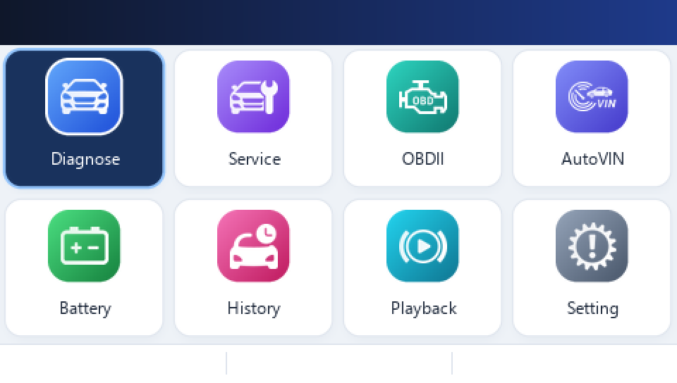
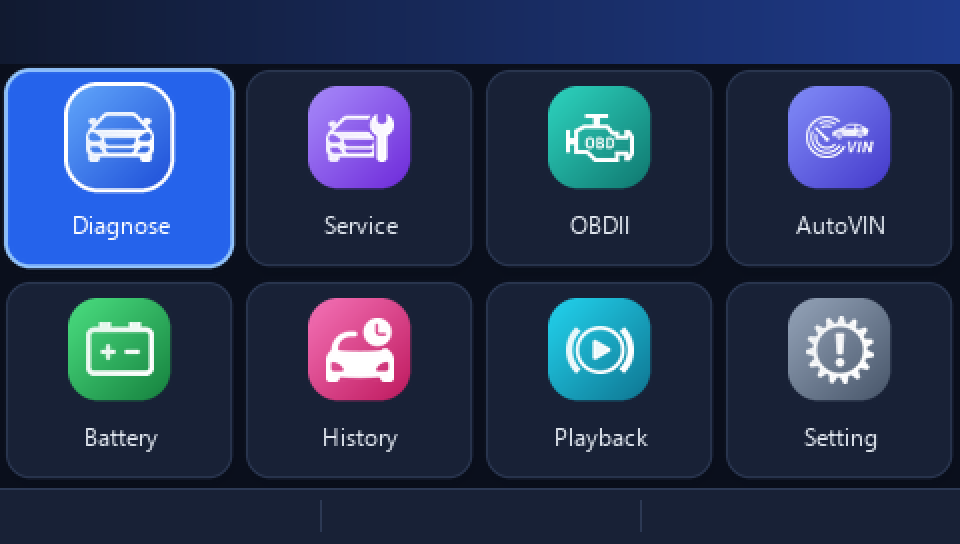
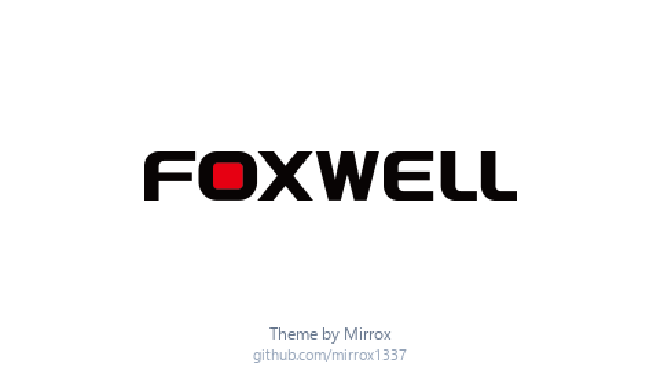
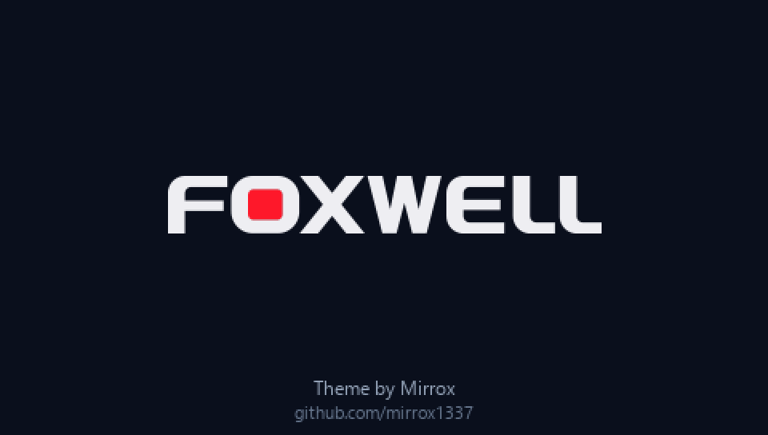

# Foxwell scanner theme — modern light and dark

A redesigned theme for Foxwell handheld scanners with a 480×272 screen: rounded cards, colored icon
tiles, a navy title bar, and a full dark mode.

Theme by Mirrox — https://github.com/mirrox1337

> **Dark theme and the custom firmware pack are confirmed working on one scanner running Home V2.07.001.** The light theme is untested. Back up your scanner's `/Res/Theme` folder before copying anything.
>
> **Vibe-coded.** This theme, the generator script and the firmware notes were made with an AI coding
> assistant (Claude Code) and have not been reviewed line by line.

| Light | Dark |
|---|---|
|  |  |
|  |  |

The labels in the home previews are a mock-up; the scanner draws its own text.

## What's in here

| Path | What it is |
|---|---|
| `Picture/` | The original theme pictures (source for the generator) |
| `Picture_modern/` | Light theme |
| `Picture_dark/` | Dark theme |
| `theme_dark.txt` | Color overrides that make the scanner's own text light — needed for the dark theme |
| `Focus_extra_light/`, `Focus_extra_dark/` | Optional highlighted tiles for the selected home item |
| `CFW/` | Custom firmware pack: dark theme, Swedish texts, credits, brand pictures — see `CFW/README.md` |
| `tools/build_cfw.py`, `patch_home.py`, `dark_vehicles.py`, `no_white.py`, `fwtool.py` | Build the pack, patch `Home.bin`, check checksums |
| `tools/modernize.py` | Script that generates everything above from `Picture/` |
| `THEME_NOTES.md` | How the firmware picks its colors, and the `theme.txt` format |

Every generated picture keeps the original's file name, size and 24-bit BMP header.

## Install

Light theme:

1. Back up `/Res/Theme` on the scanner's memory card.
2. Copy the contents of `Picture_modern/` over `/Res/Theme/Picture/`.

Dark theme:

1. Back up `/Res/Theme`.
2. Copy the contents of `Picture_dark/` over `/Res/Theme/Picture/`.
3. Copy `theme_dark.txt` to `/Res/Theme/` and rename it `theme.txt`.

Optional: copy the files from `Focus_extra_dark/home/` (or `Focus_extra_light/home/`) into
`/Res/Theme/Picture/home/`. If the home screen misbehaves, delete them again.

To undo, restore your backup. Deleting `theme.txt` alone returns the colors to the built-in defaults.

## Rebuild

Needs Python 3 and Pillow (`pip install pillow`). The credit text uses Segoe UI from Windows.

```
python tools/modernize.py Picture Picture_modern
python tools/modernize.py Picture Picture_dark dark
```

Colors, the credit line and the per-tile palette are set near the top of the script.

## Disclaimer

- **Vibe-coded:** everything here was produced with an AI coding assistant (Claude Code). The notes on
  how the firmware works come from reading the firmware file, not from testing, and may be wrong.
- **Unofficial:** not affiliated with Foxwell. The original pictures and logos belong to their owner.
- **Use at your own risk:** keep a backup of your scanner's files.
